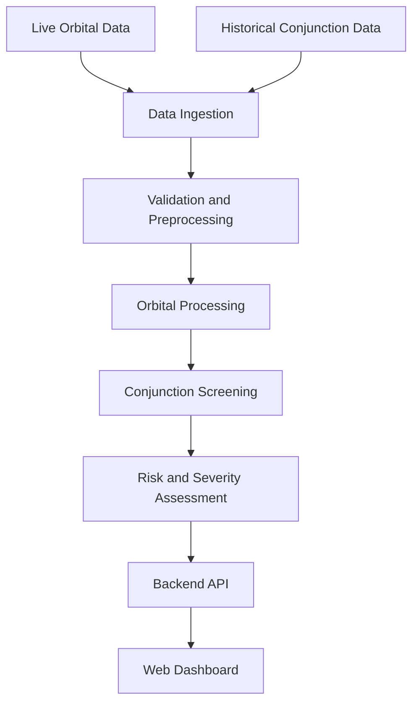

# 🛰️ Gagan Suraksha

### AI-Powered Satellite Collision Risk Assessment & Space Situational Awareness

**Making Earth's orbital environment safer through intelligent monitoring.**

Gagan Suraksha is a space situational awareness project designed to analyze satellite conjunctions, process orbital data, and assess potential collision risks using historical conjunction records, orbital mechanics, and machine-learning-assisted severity analysis.

As the number of satellites and debris objects in Earth's orbit increases, monitoring potentially dangerous close approaches becomes increasingly important. Gagan Suraksha aims to turn orbital data into actionable insights through an integrated backend and web interface.

---

## 🌌 Project Overview

- 🛰️ **Orbital Data Monitoring** — Integration with configured orbital data providers.
- 📚 **Historical Conjunction Analysis** — Processing historical conjunction records for analysis and evaluation.
- 🎯 **Conjunction Screening** — Identifying potentially close approaches between orbital objects.
- 🧠 **ML-Assisted Risk Assessment** — Severity analysis using available conjunction features.
- 🌍 **Orbital Propagation** — Orbital calculations using compatible propagation tools such as SGP4.
- 📊 **Data Visualization** — Presenting available orbital and conjunction information through the application interface.
- 🧪 **Automated Testing** — Tests for API endpoints, historical processing, orbital providers, propagation, and ML integration.

## ⚙️ How It Works



1. Collect orbital data from configured sources.
2. Validate and preprocess orbital and historical records.
3. Process orbital information and screen potential close approaches.
4. Assess conjunction severity using the implemented analysis pipeline.
5. Present available results through the application interface.

## 🛠️ Technology Stack

- **Backend:** Python, FastAPI, Uvicorn
- **Frontend:** TypeScript and JavaScript-based tooling
- **Orbital Data:** CelesTrak and configured data providers
- **Orbital Mechanics:** SGP4-compatible propagation
- **Machine Learning:** Python-based ML and severity pipeline
- **Testing:** Pytest
- **Version Control:** Git and GitHub

## 📂 Repository Structure

```text
Gagan-Suraksha/
├── backend/
├── tests/
├── conjunctions_data.json
├── README.md
└── ...
```

## 🚀 Getting Started

### Prerequisites

- Git
- Python version supported by the project dependencies
- Node.js and npm, if required by the frontend
- API credentials for providers that require authentication

### 1. Clone the Repository

```bash
git clone https://github.com/Avneet-Chahal/Gagan-Suraksha.git
cd Gagan-Suraksha
```

### 2. Set Up the Backend

Create and activate a virtual environment in PowerShell:

```powershell
python -m venv backend\.venv
.\backend\.venv\Scripts\Activate.ps1
```

Install dependencies using the dependency file included in the project. For example, if `backend\requirements.txt` exists:

```powershell
pip install -r backend\requirements.txt
```

### 3. Configure Environment Variables

If required, create a local `.env` file and add the configuration variables expected by the application.

Never commit API keys, passwords, or private credentials to GitHub.

### 4. Start the Backend

Use the Uvicorn command appropriate for the backend's actual entry point and package structure.

The API documentation may be available at:

`http://127.0.0.1:8000/docs`

### 5. Start the Frontend

Navigate to the directory containing the frontend's `package.json` and run:

```bash
npm install
npm run dev
```

Open the local URL displayed in your terminal.

## 📡 Data Sources

- **[CelesTrak](https://celestrak.org/)** — Public orbital element data.
- **[Space-Track](https://www.space-track.org/)** — Orbital and space surveillance information, subject to access and provider terms.
- **Historical Conjunction Records** — Historical data used for analysis, validation, and model development according to its documented source and format.

Data availability, refresh frequency, and supported features depend on the configured providers.

## 🧠 Historical Data & Machine Learning

Historical conjunction records can help analyze close approaches and develop risk-assessment methods.

Reliable model development requires careful validation of timestamps, object identifiers, units, duplicate events, and missing values. Model evaluation should use appropriate validation datasets and report only measured results.

**Important scientific limitation:** A close approach does not necessarily mean a collision occurred. A genuine collision-outcome prediction model requires reliable collision labels or verified outcome records. Without these, the system should be described as a risk-ranking or severity-assessment tool rather than a proven collision predictor.

## 🧪 Testing

The repository includes tests for components such as:

- API endpoints and application health
- Historical data ingestion and processing
- Orbital data providers
- Orbital propagation and SGP4
- Conjunction screening
- ML integration and severity assessment
- Persistence and end-to-end processing

Run the test suite using the project's configured Python environment:

```bash
python -m pytest -v
```

Actual test results should be verified before claiming that all tests pass.

## 🔭 Future Scope

- Improve live orbital data refresh and stale-data monitoring.
- Expand historical conjunction datasets and validation.
- Improve risk assessment using uncertainty-aware inputs.
- Evaluate ML models using reliable labels and leakage-resistant splits.
- Enhance orbital visualization and dashboard usability.
- Add monitoring and notification workflows.
- Improve deployment and automated testing.

## ⚠️ Disclaimer

Gagan Suraksha is a research and development project. Its outputs are intended to support analysis and learning and should not replace authoritative conjunction warnings or validated collision assessments from professional space surveillance organizations.

## 👨‍💻 Author

**Avneet Chahal**

GitHub: [@Avneet-Chahal](https://github.com/Avneet-Chahal)

**Project Repository:** [Gagan Suraksha](https://github.com/Avneet-Chahal/Gagan-Suraksha)

## 📄 License

A license has not yet been specified in this README. Add an appropriate `LICENSE` file before distributing the project or granting reuse permissions.

---

<p align="center">
  <strong>Gagan Suraksha</strong><br>
  <em>Intelligent Monitoring for a Safer Orbital Environment.</em>
</p>
